# Bug Report: Team Task Board v1.0.0

- **Tested by:** Jyothirmai Moparthi
- **Spec:** [team-task-board-jira](https://github.com/Cymmetric-Pixel/team-task-board-jira) tickets TTB-0 to TTB-9
- **Environment:** Windows 11, Google Chrome, local dev server (`npm run dev`)
- **Approach:** I turned each ticket's acceptance criteria into manual test cases, using negative and boundary testing, then explored beyond the spec. I ran 30 test cases in total.

## Recommendation: Not ready to ship

Every ticket is marked Done, but three critical bugs mean users can lose work without knowing it:

- Deleted tasks come back after a refresh.
- Marking a task complete is never saved, and the Active/Completed filters ignore it.
- When saving a new task fails, the app still shows a green "Task added." banner.

I'd hold the 1.0.0 release until these three are fixed.

## Summary

| ID | Severity | Ticket | Bug |
|----|----------|--------|-----|
| BUG-01 | Critical | TTB-3, TTB-8 | Deleted tasks come back after refresh or after the next delete |
| BUG-02 | Critical | TTB-4, TTB-5, TTB-8, TTB-9 | Completing a task is not saved; filters ignore it; no banner |
| BUG-03 | Critical | TTB-9 | A failed create shows a green "Task added." banner |
| BUG-04 | High | TTB-7 | Priority sort shows High, Low, Medium |
| BUG-05 | High | TTB-1, TTB-2 | Titles with only spaces are accepted |
| BUG-06 | High | TTB-1, TTB-2 | Past due dates are accepted |
| BUG-07 | Medium | TTB-5 | The Completed filter shows archived tasks |
| BUG-08 | Medium | TTB-6 | Search is case-sensitive |
| BUG-09 | Low | TTB-9 | A failed create or edit throws away what the user typed |
| BUG-10 | Low | TTB-2 | "Close" keeps an unsaved draft, unlike "Cancel" |
| BUG-11 | Low | TTB-2 | The edit form's error message is not styled red |

---

## Critical

### BUG-01: Deleted tasks come back after refresh or after the next delete
**Severity:** Critical | **Tickets:** TTB-3, TTB-8 | **Tests:** 11, 13

**Steps**
1. Have three tasks in the list: "close test orginial", "MEAL PREP", "GYM".
2. Click **Delete** on "close test orginial". It disappears and a green "Task deleted." banner appears.
3. Refresh the page.

**Expected:** The deleted task stays gone after a refresh (TTB-3: "The deletion is persisted").

**Actual:** "close test orginial" comes back after the refresh. The app told me it was deleted, but it wasn't.

I also tried deleting tasks one after another without refreshing. Only the first delete seemed to work. Each delete after that brought back a task I had already deleted, so I could never empty the list or reach the "No tasks to show." state that TTB-3 requires.

**Screenshots**
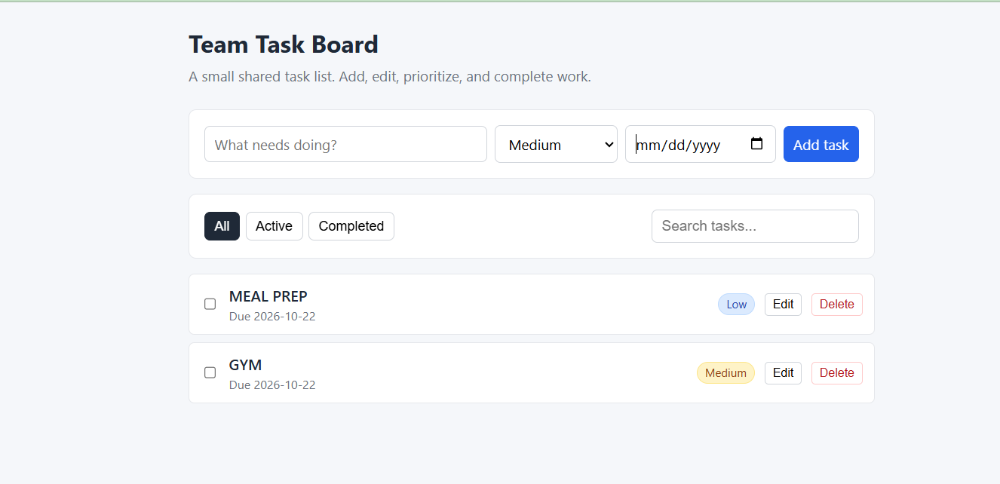
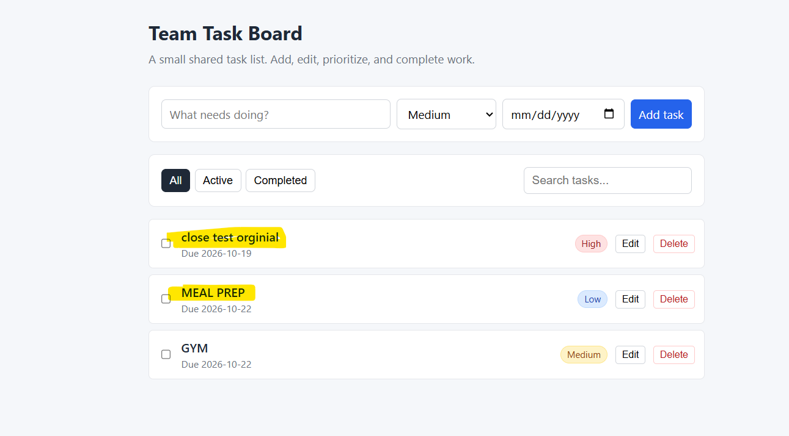
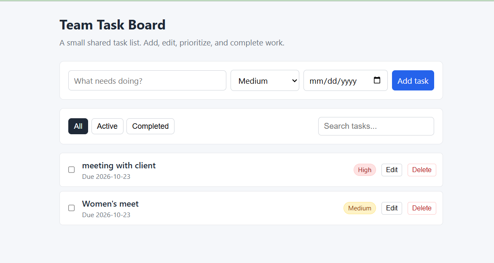

**Root cause:** In `src/api/fakeTaskApi.ts`, `deleteTask()` builds the remaining list and returns it, but never writes it back to localStorage. The next read from storage still has every task.

**Suggested fix:** Call `writeToStorage(remaining)` before returning.

---

### BUG-02: Completing a task is not saved, and the filters ignore it
**Severity:** Critical | **Tickets:** TTB-4, TTB-5, TTB-8, TTB-9 | **Tests:** 14, 15, 16, 22

**Steps**
1. With "Potluck" (Low) and "Women's Meet" (Medium) in the list, tick "Women's Meet". The title gets a strikethrough, and Potluck is unchanged.
2. Click **Active**, then **Completed**.
3. Refresh the page.

**Expected**
- A green banner confirms the change (TTB-9).
- Active hides the completed task, and Completed shows it (TTB-5).
- After a refresh, the task is still ticked (TTB-4).

**Actual**
- No banner appears.
- Active still shows the ticked task, and Completed shows "No tasks to show."
- After a refresh, the task is unticked again.
- Search combined with filters is affected the same way: Active plus a search still shows the ticked task.

The tick only changes what's on the screen. The app's data never learns the task is complete.

**Screenshots**
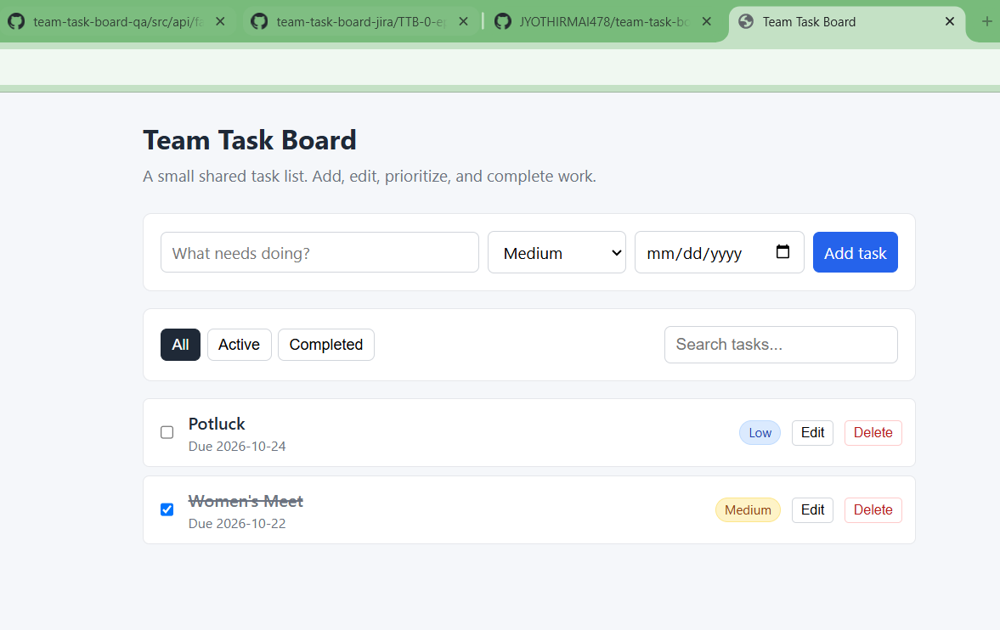
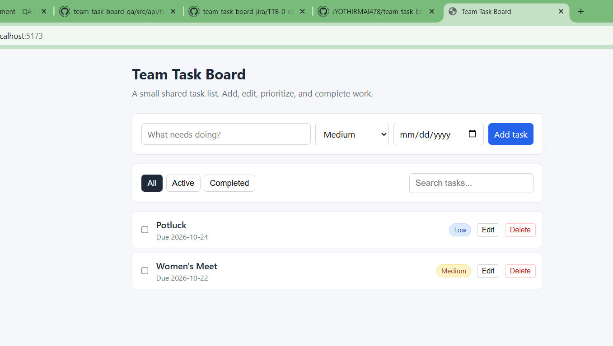
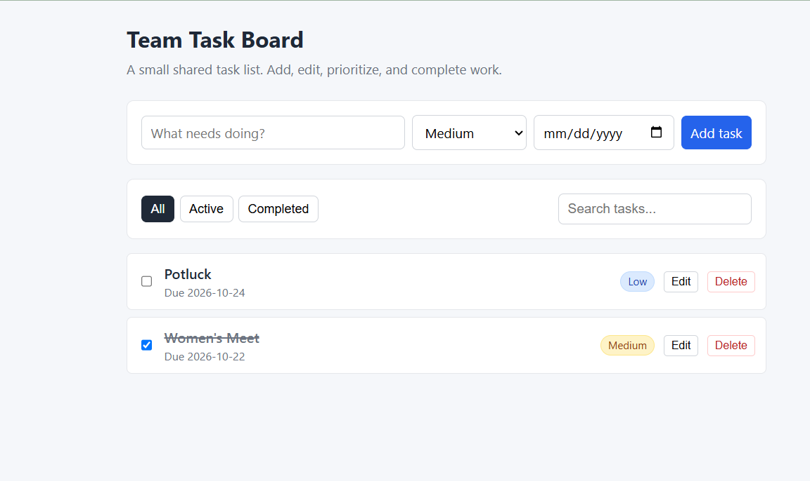
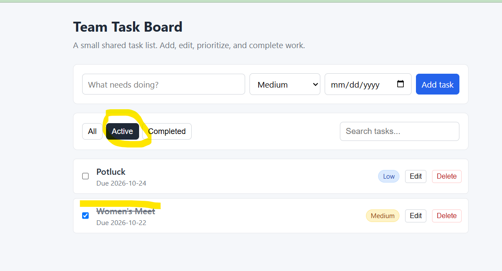
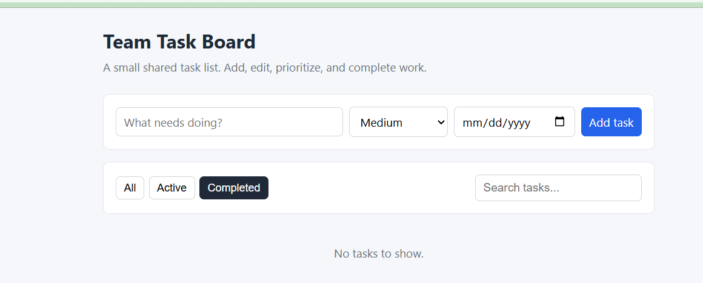
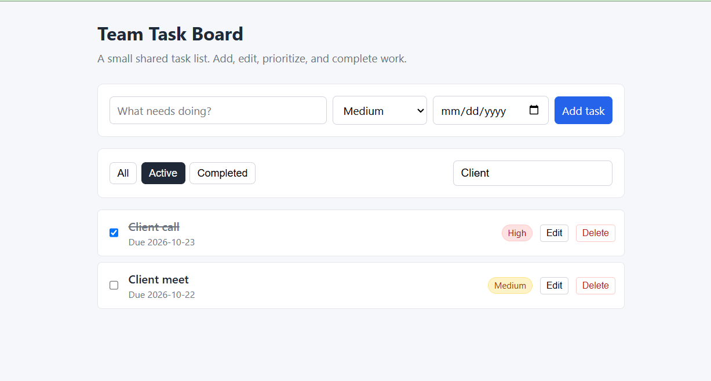

**Root cause:** In `src/components/TaskItem.tsx`, the checkbox flips a local `completed` state and never calls `onEdit` / `updateTask`. TTB-4's technical note warns against leaving the state only in the component.

**Suggested fix:** Use `task.completed` for the checkbox and call `onEdit(task.id, { completed: !task.completed })` on change.

---

### BUG-03: A failed create shows a green "Task added." banner
**Severity:** Critical | **Ticket:** TTB-9 | **Test:** 28

**Steps**
1. Set `SIMULATE_FAILURE = true` in `src/api/fakeTaskApi.ts` and refresh the app.
2. Type a title and click **Add task**.

**Expected:** A red error banner, and no task added. TTB-9: "A success banner is **never** shown for a failed save."

**Actual:** A green "Task added." banner appears, but no task is added. A user would believe their task was saved when it wasn't.

Failed edits and deletes correctly show red banners ("Failed to update task." and "Failed to delete task."). Only create is wrong.

**Screenshots**
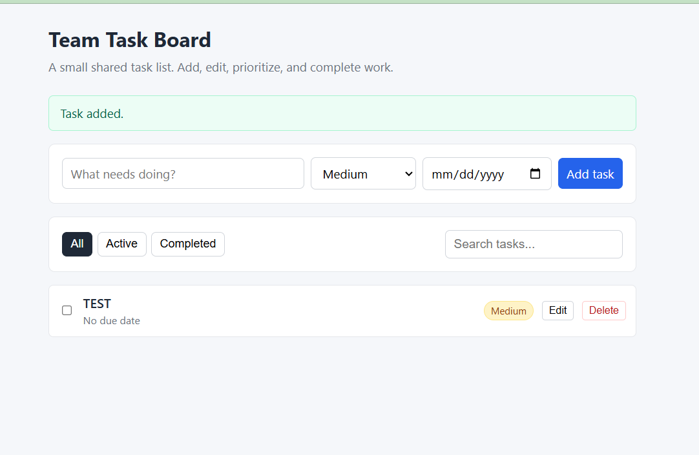
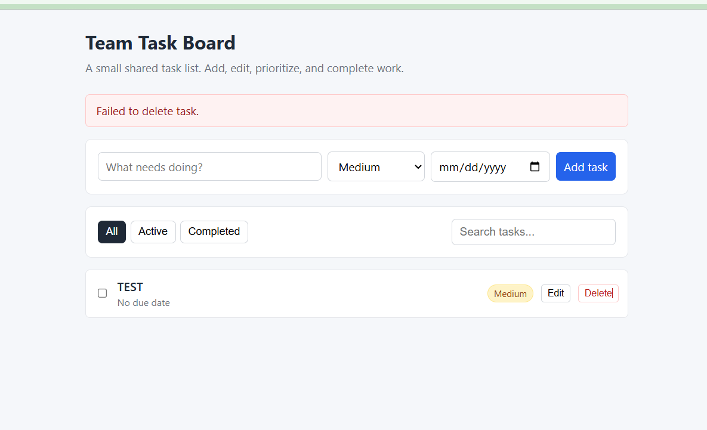

**Root cause:** In `src/App.tsx`, the `catch` block of `handleCreate` sets a success banner ("Task added.") instead of an error banner.

**Suggested fix:** Set `{ type: "error", text: "Failed to add task." }` in the `catch` block.

---

## High

### BUG-04: Priority sort shows High, Low, Medium
**Severity:** High | **Ticket:** TTB-7 | **Tests:** 23, 24

**Steps:** Add TASK A (Low), TASK B (Medium), TASK C (High), in that order.

**Expected:** C, B, A (High, Medium, Low). This is the first example table in TTB-7.

**Actual:** C, A, B. Low appears above Medium. Tasks with the same priority do keep the order they were added in, and the order is the same after a refresh.

**Screenshots**
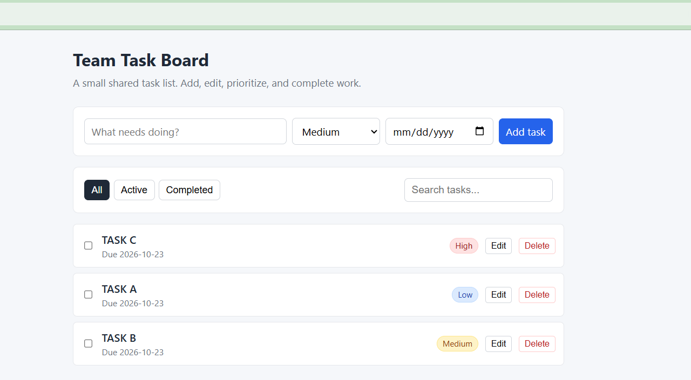
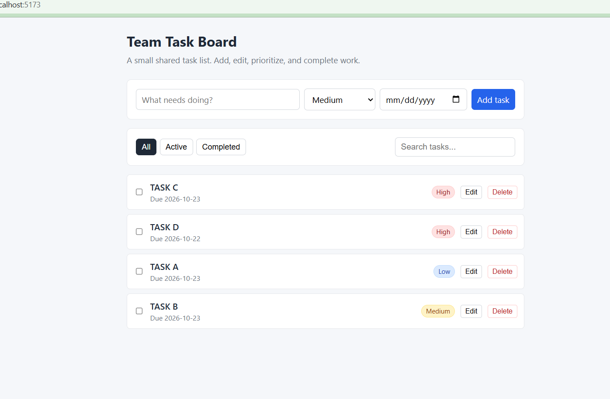

**Root cause:** `src/logic/taskSorting.ts` compares priorities alphabetically with `localeCompare` ("high" < "low" < "medium").

**Suggested fix:** Use the rank map from TTB-7's technical note: `{ high: 0, medium: 1, low: 2 }`.

---

### BUG-05: Titles with only spaces are accepted
**Severity:** High | **Tickets:** TTB-1, TTB-2 | **Tests:** 2, 9

**Steps**
1. Type three spaces in the title box and click **Add task**.
2. Separately, edit an existing task, replace its title with spaces, and click **Save**.

**Expected:** "Title is required." TTB-1 says a whitespace-only title is treated like an empty one.

**Actual:** A task with a blank title is created, and edits save a blank title. A completely empty title is correctly rejected.

**Screenshots**
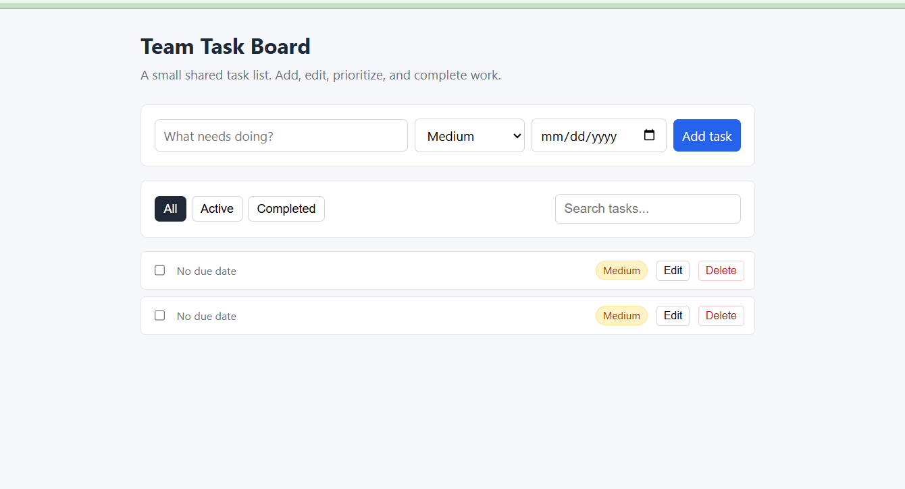
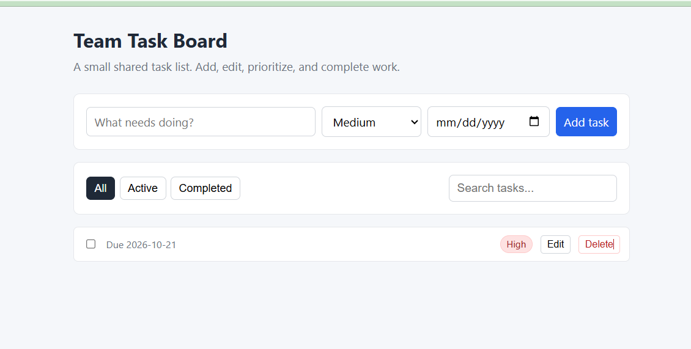

**Root cause:** `src/logic/taskValidation.ts` checks `title.length === 0` without trimming spaces first.

**Suggested fix:** Check `title.trim().length === 0`.

---

### BUG-06: Past due dates are accepted
**Severity:** High | **Tickets:** TTB-1, TTB-2 | **Tests:** 4, 5, 9

**Steps**
1. Type "emails follow up", pick yesterday's date (10/20/2026), and click **Add task**.
2. Separately, edit a task, replace the title with spaces, set the date to 10/19/2026, and click **Save**.

**Expected:** An inline error. TTB-1 says the due date must be today or later.

**Actual:** Both are saved with no error. On the edit, the blank title and the past date were both saved. Today's date (10/21/2026) is correctly accepted on create.

**Screenshots**
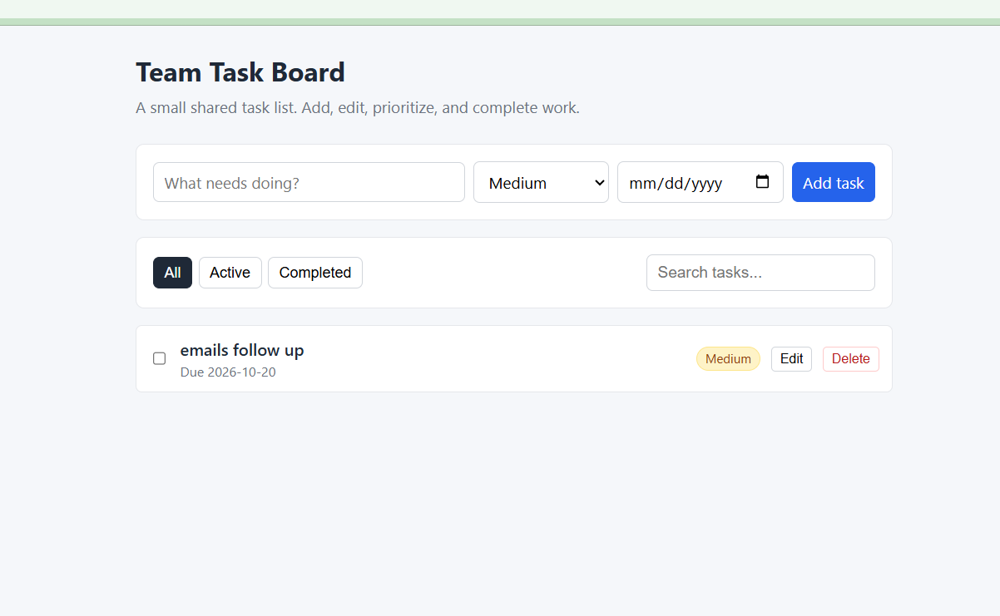
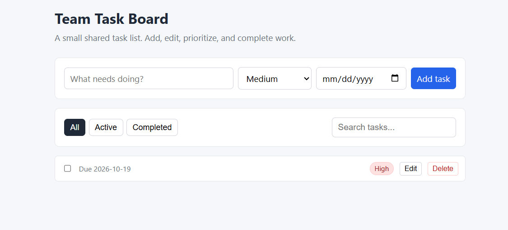

**Root cause:** `src/logic/taskValidation.ts` only checks that the date is a real date, never that it's today or later.

**Suggested fix:** Compare the date to today's local date. Be careful with time zones: `new Date("2026-10-21")` is read as UTC midnight, so a simple comparison can wrongly reject today for users in the US in the evening.

---

## Medium

### BUG-07: The Completed filter shows archived tasks
**Severity:** Medium | **Ticket:** TTB-5 | **Test:** 18

Archive isn't in the UI yet (it's planned for v1.1), but TTB-5 says every filter must already hide archived tasks.

**Setup:** Since I couldn't archive a task through the app, I added three tasks directly to localStorage using the DevTools Console:
- "Normal task": not completed, not archived
- "Archived active": not completed, archived
- "Archived done": completed, archived

**Steps:** Refresh, then click All, Active, and Completed.

**Expected:** All and Active show only "Normal task". Completed shows "No tasks to show."

**Actual:** All and Active are correct, but Completed shows "Archived done".

**Screenshot**
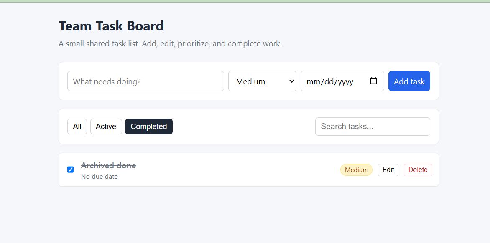

**Root cause:** In `src/logic/taskFiltering.ts`, the `"completed"` branch doesn't call the `isVisible()` helper, which the other two branches use.

**Suggested fix:** `tasks.filter((t) => isVisible(t) && t.completed)`.

**Why it matters now:** No one can reach this today, but archived tasks will leak into the Completed view as soon as archive ships.

---

### BUG-08: Search is case-sensitive
**Severity:** Medium | **Ticket:** TTB-6 | **Test:** 20

**Steps:** With "Client call" and "Client meet" in the list, search for `Client`, then `client`, then `CLIENT`.

**Expected:** All three find both tasks. TTB-6: "Search is case-insensitive."

**Actual:** `Client` finds both tasks. `client` shows "No tasks to show." `CLIENT` and `TEAM` (for "Team Lunch") also show "No tasks to show."

**Screenshots**
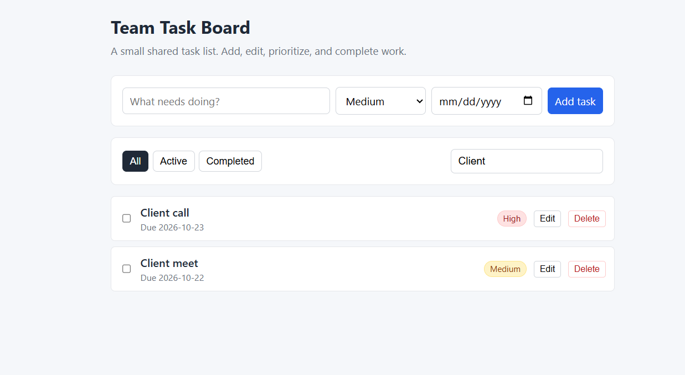

**Root cause:** `src/logic/taskFiltering.ts` uses `title.includes(query)` without making both sides the same case.

**Suggested fix:** Compare `title.toLowerCase()` with `query.toLowerCase()`.

---

## Low

### BUG-09: A failed create or edit throws away what the user typed
**Severity:** Low | **Ticket:** TTB-9 | **Tests:** 28, 29

**Steps:** With `SIMULATE_FAILURE = true`, (a) add a task, or (b) edit a task and click **Save**.

**Expected:** The text stays in the form or editor so the user can try again. TTB-9's user story is about knowing whether to retry.

**Actual:** (a) The form clears. (b) The red "Failed to update task." banner is correct, but the editor closes and the change is lost.

**Screenshot**
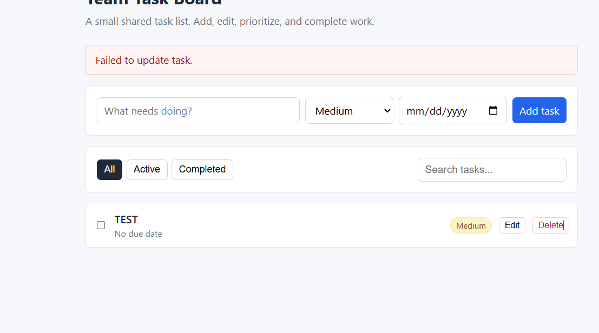

**Root cause:** `App.tsx` catches the error, so `TaskForm` and `TaskItem` can't tell the save failed and always clear or close.

---

### BUG-10: "Close" keeps an unsaved draft, unlike "Cancel"
**Severity:** Low | **Ticket:** TTB-2 | **Test:** 10

**Steps**
1. Click **Edit** on a task saved as "close test orginial".
2. Change the title to "close test" without saving.
3. Click **Close** (the Edit button's label while editing).
4. Click **Edit** again.

**Expected:** The editor shows the saved title, just like after Cancel.

**Actual:** The editor shows the unsaved "close test". If the user then clicks Save, they may save a change they meant to throw away.

**Screenshot**
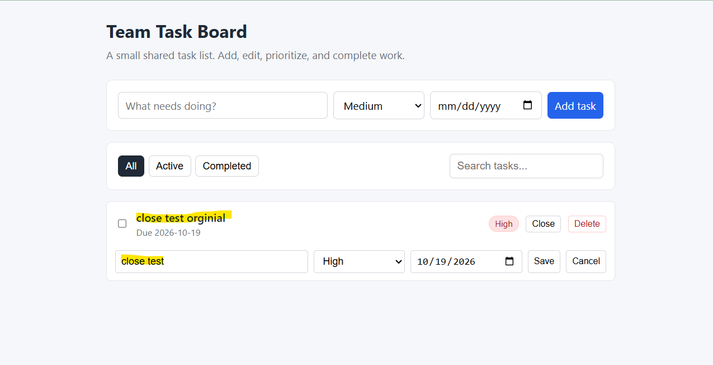

**Root cause:** In `src/components/TaskItem.tsx`, the Edit/Close button only toggles the editor and doesn't reset the draft the way `handleCancelEdit` does.

---

### BUG-11: The edit form's error message is not styled red
**Severity:** Low | **Ticket:** TTB-2 | **Test:** 9

**Actual:** "Title is required." shows in red on the create form but in plain dark text in the edit row.

**Root cause:** In `src/styles.css`, the red style is written as `.task-form .form-error`, so it only applies inside the create form.

---

## Observations (not bugs)

- **Same-priority tasks aren't ordered by due date (TTB-7).** TASK D (High, due 10/22) shows below TASK C (High, due 10/23) because C was added first. This matches the ticket, but sorting by due date within the same priority could help users see urgent work first. Worth raising with Product.
- **No confirmation on delete (TTB-3).** One click permanently deletes a task with no undo. That's expected for 1.0.0, but an undo option would be worth considering.
- **Failure mode needs a code change (TTB-8).** Testing the error path means editing `SIMULATE_FAILURE` and reloading. A setting that doesn't need a code change would make this easier for QA and automated tests.

## Test summary

| Ticket | Tests | Pass | Fail | Partial |
|--------|-------|------|------|---------|
| TTB-1 Create | 1–5 | 3 | 2 | 0 |
| TTB-2 Edit | 6–10 | 3 | 2 | 0 |
| TTB-3 Delete | 11–13 | 1 | 2 | 0 |
| TTB-4 Complete | 14–16 | 0 | 2 | 1 |
| TTB-5 Filter | 17–18 | 1 | 1 | 0 |
| TTB-6 Search | 19–22 | 2 | 2 | 0 |
| TTB-7 Sort | 23–25 | 1 | 1 | 1 |
| TTB-8 Persistence | 26–27 | 2 | 0 | 0 |
| TTB-9 Feedback | 28–30 | 1 | 1 | 1 |
| **Total** | **30** | **14** | **13** | **3** |
